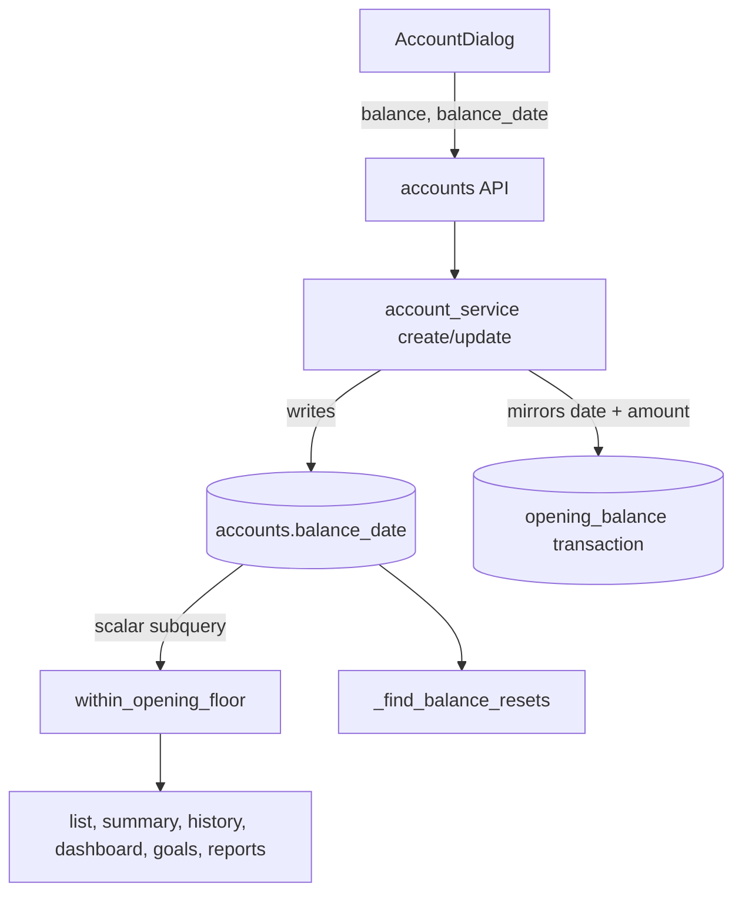

# Account Balance Date Design

**Spec**: `.specs/features/account-balance-date/spec.md`
**Status**: Approved (owner said "pode seguir" on the plan)

---

## Architecture Overview

One new column is the source of truth. Writes keep the synthetic `opening_balance` transaction in step with it; reads swap the subquery inside the existing `within_opening_floor` for a scalar subquery on `accounts`, so the 10 call sites do not change.



---

## Code Reuse Analysis

| Component | Location | How to Use |
| --------- | -------- | ---------- |
| `within_opening_floor` | `backend/app/services/_query_filters.py:57` | Keep signature; change body to read `Account.balance_date` |
| `create_account` / `update_account` | `backend/app/services/account_service.py:267`, `:306` | Store the date, keep the opening transaction in step |
| `_find_balance_resets` | `backend/app/services/report_service.py:305` | Read `Account.balance_date` instead of max opening date |
| `AccountRead`, `AccountCreate`, `AccountUpdate` | `backend/app/schemas/account.py` | Add `balance_date` to the read model |
| `AccountDialog` | `frontend/src/pages/accounts.tsx:668` | Initialize the date from the account in edit mode, add the hint |
| Existing floor tests | `backend/tests/test_opening_floor.py`, `test_account_service.py`, `test_accounts_api.py`, `test_dashboard_service.py`, `test_report_service.py` | Keep passing unchanged; fixtures that create the opening row directly must also set `balance_date` (see Risks) |
| Alembic style | `backend/alembic/versions/097_import_mappings.py` | Next revision is `098` |

### Integration Points

| System | Integration Method |
| ------ | ------------------ |
| Bank sync | `sync_opening_balance_for_connected_account` keeps managing the synthetic row; `balance_date` stays NULL for connected accounts |
| Restore to dev | `restore-to-dev.sh` lets the backend run `alembic upgrade head`, which applies `098` |

---

## Components

### Floor filter
- **Purpose**: "this transaction counts at cutoff c" using the account's saved date.
- **Location**: `backend/app/services/_query_filters.py`
- **Interface**: `within_opening_floor(cutoff: date)` unchanged.
- **Logic**: `bd = select(Account.balance_date).where(Account.id == Transaction.account_id).scalar_subquery()`; predicate `or_(bd.is_(None), cutoff < bd, Transaction.date >= bd)`.
- **Reuses**: existing function and its 10 call sites.

### Account writes
- **Purpose**: persist the date and mirror it.
- **Location**: `backend/app/services/account_service.py`
- **Rules** (manual accounts only):
  - create: `account.balance_date = data.balance_date or app_today()`; opening transaction only when balance != 0, dated `account.balance_date`.
  - update: if `balance_date` in payload set `account.balance_date` and, if an opening transaction exists, its `date` (and effective date). If `balance` in payload: non-zero creates or updates the opening transaction dated `account.balance_date or app_today()` (and sets `account.balance_date` if it was null); zero deletes the opening transaction and keeps `balance_date`.
  - connected accounts: ignore `balance_date`, leave NULL.

### Net-worth reset notice
- **Location**: `backend/app/services/report_service.py` (`_find_balance_resets`)
- **Change**: candidates are accounts with `Account.balance_date` in `(window_start, window_end]` that have at least one non-ignored, non-opening transaction dated before it.

### Account dialog
- **Location**: `frontend/src/pages/accounts.tsx`, `frontend/src/types/index.ts`, `frontend/src/locales/*`
- **Change**: `balanceDate` initial value is `account?.balance_date ?? localDateString()`; hint `accounts.balanceDateHint` under the field; payload rule from the previous release is unchanged (send `balance`/`balance_date` only when changed).

---

## Data Models

```python
# models/account.py
balance_date: Mapped[Optional[date]] = mapped_column(Date, nullable=True)
```

Migration `098` (down `097`): add the column; backfill with

```sql
UPDATE accounts SET balance_date = (
  SELECT max(t.date) FROM transactions t
  WHERE t.account_id = accounts.id AND t.source = 'opening_balance'
) WHERE connection_id IS NULL;
```

Downgrade drops the column.

---

## Error Handling Strategy

| Error Scenario | Handling | User Impact |
| -------------- | -------- | ----------- |
| Invalid date string | Pydantic validation, HTTP 422 | Field error |
| `balance_date` sent for a connected account | Ignored | None |
| Opening transaction date differs from account | Account wins; the next write realigns | None |

---

## Risks & Concerns

| Concern | Location (file:line) | Impact | Mitigation |
| ------- | -------------------- | ------ | ---------- |
| Tests that create the opening transaction directly (fixtures) will no longer produce a floor | `backend/tests/test_opening_floor.py`, `test_account_service.py`, `test_accounts_api.py`, `test_dashboard_service.py`, `test_report_service.py` | Spec-derived tests fail for fixture reasons | Fixtures must set `account.balance_date` too (or go through the service); this is a fixture update, not a weakened assertion. If a test's expected outcome would change, stop and report |
| Backfill changes nothing on purpose | migration `098` | Wrong date would shift balances | Backfill copies the exact date the floor uses today; migration test compares balances before and after |
| Correlated subquery on `accounts` in every balance query | `_query_filters.py:57` | Perf | Primary-key lookup per row group; same cost class as the previous subquery on `transactions`, which was heavier (no index on source) |
| Dev databases restored from older backups | `restore-to-dev.sh` | Missing column | Backend runs `alembic upgrade head` at start |
| Migration only verified up to 097 on a scratch Postgres | alembic | Chain not runnable locally (pgvector) | Run upgrade/downgrade of 098 on a scratch Postgres stamped at 097, as done for 097 |

---

## Tech Decisions (only non-obvious ones)

| Decision | Choice | Rationale |
| -------- | ------ | --------- |
| Subquery on `accounts` instead of joining | Scalar subquery in `within_opening_floor` | No caller changes; the 10 sites keep working |
| Connected accounts | `NULL` | Provider balance is authoritative; floor was a no-op |
| Keep the opening transaction | Mirror of date and amount | Reports and history already depend on it |

> **Project-level decision:** supersedes the storage part of AD-001 (the date now lives on `accounts.balance_date`); recorded as AD-002 in `.specs/STATE.md`.
