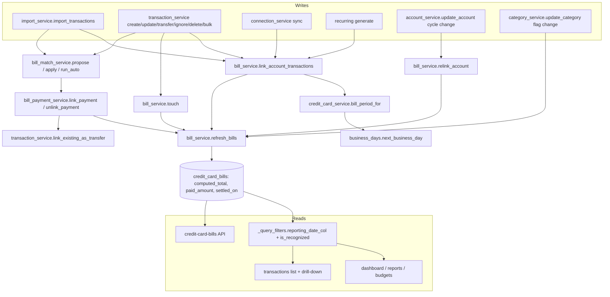

# Credit Card Bills Design

**Spec**: `.specs/features/credit-card-bills/spec.md`
**Status**: Approved (approach chosen by the owner on 2026-10-12: aggregates stored on the bill)

---

## Architecture Overview

The bill becomes the anchor for every card transaction and every bill payment. One service owns the bill's stored aggregates (`computed_total`, `paid_amount`, `settled_on`); every write path that can change them calls it. Status and remaining amounts that depend on "today" stay derived at read time. The `settlement` accounting mode reads `settled_on` through the existing `reporting_date_col` choke point, with a primary-key lookup on the bill, like AD-002 did for `balance_date`.



**Flow of the reference case.** Import of the Nubank card CSV → `link_account_transactions` creates bill 2026-09 (close 2026-09-05, nominal due 2026-09-12, effective due 2026-09-14) and links the rows → `refresh_bills` stores `computed_total = 1283.20` → import of the checking CSV → `run_auto_match` finds one candidate (2026-09-14 within `[2026-09-05, 2026-09-19]`, amount equal to remaining) → `link_payment` sets `paid_bill_id`, pairs it with the card's "Pagamento recebido" credit if present, refreshes → `paid_amount = 1283.20`, `settled_on = 2026-09-14` → in `settlement` mode the card purchases count in September on 2026-09-14.

---

## Code Reuse Analysis

### Existing Components to Leverage

| Component | Location | How to Use |
| --------- | -------- | ---------- |
| `compute_effective_date`, `_clamp_day` | `backend/app/services/credit_card_service.py` | Same close-day and clamp rules; `bill_period_for` generalizes them to return the whole period |
| `apply_effective_date` | `backend/app/services/credit_card_service.py:71` | Unchanged; still stamps `effective_date` (nominal due) for `accrual` |
| `CreditCardBill` + `Transaction.bill_id` | `backend/app/models/credit_card_bill.py`, `backend/app/models/transaction.py:91` | Extended in place, no new bill table |
| `_resync_bill_link_from_override` | `backend/app/services/transaction_service.py:1265` | Kept for provider bills; manual-override linking for non-provider bills moves into `bill_service` |
| `reporting_date_col`, `counts_as_pnl` | `backend/app/services/_query_filters.py:99`, `:164` | Single place to add the `settlement` date and the bill-payment exclusions |
| `link_existing_as_transfer`, `unlink_transfer_pair` | `backend/app/services/transaction_service.py:1123`, `backend/app/services/transfer_detection_service.py:599` | Pair the payment with the card credit; unpair on unlink |
| Transfer rule window (`_widest_window`) | `backend/app/services/transfer_detection_service.py:80` | Date window for finding the card credit leg |
| propose/apply split | `backend/app/services/transfer_detection_service.py:395`, `:549` | Same shape for `bill_match_service.propose_matches` / `apply_matches` |
| `get_credit_card_accounting_mode` + admin setting whitelist | `backend/app/services/admin_service.py:257`, `backend/app/api/admin.py:150` | Add `settlement` |
| `_get_forecast_transactions` | `backend/app/services/dashboard_service.py` | Pattern for adding settlement projections to projected totals |
| `treat_as_transfer` flag | `backend/app/models/category.py:36`, `frontend/src/pages/categories.tsx` | Same column, schema and toggle pattern for `is_bill_payment` |
| `TransferApplyDialog` | `frontend/src/components/transfer-apply-dialog.tsx` | Same preview-with-checkboxes UI for the bulk match preview |
| `LinkTransferDialog` | `frontend/src/components/link-transfer-dialog.tsx` | Same candidate-list dialog shape for "Vincular a fatura" |
| `TransactionDrillDown` | `frontend/src/components/transaction-drill-down.tsx` | Extend row rendering; it already reads the accounting mode |
| Account detail cycle UI | `frontend/src/pages/account-detail.tsx` | Reuse the summary card and transaction table pieces in the consolidated page by extracting them |
| Migration data-backfill precedent | `backend/alembic/versions/098_account_balance_date.py`, `backend/tests/test_account_balance_date_migration.py` | Same test style for the bill backfill |

### Integration Points

| System | Integration Method |
| ------ | ------------------ |
| Import (`import_service.import_transactions`) | After rows are flushed: `link_account_transactions(account)` for card accounts, `run_auto_match(workspace)` for any account; counts go to the import result |
| Transaction CRUD (`transaction_service`) | After flush on card rows: `link_account_transactions`; on any row with `bill_id`/`paid_bill_id`: `touch(tx_ids)` before delete and after update |
| Provider sync (`connection_service`) | Provider bills keep their path; after sync: `link_account_transactions` (fills months the provider did not cover) and `refresh_bills` |
| Account update (`account_service.update_account`) | When close/due day changes: `relink_account(account)` next to the existing `_recompute_effective_dates` |
| Category update (`category_service.update_category`) | When `is_bill_payment` or `is_ignored` changes: refresh every bill of the workspace |
| Dashboard / reports / budgets | `reporting_date_col(mode)` gains the `settlement` branch; mode-aware queries add `is_recognized(mode)`; dashboard adds settlement projections |
| Transactions list API | Adds per-row `reporting_date`, `is_bill_projected`, `paid_bill`, `bill_payment_suggestion`, `needs_counterpart` |
| Database | Migration `099` (schema) and `100` (backfill) |

---

## Components

### Business-day calendar

- **Purpose**: Answer whether a date is a Brazilian banking business day and roll a date forward to the next one.
- **Location**: `backend/app/core/business_days.py`
- **Interfaces**:
  - `easter_sunday(year: int) -> date` - Anonymous Gregorian algorithm.
  - `br_national_holidays(year: int) -> frozenset[date]` - fixed holidays plus Carnival Monday/Tuesday (Easter −48/−47), Good Friday (−2), Corpus Christi (+60); cached per year.
  - `is_business_day(d: date) -> bool`
  - `next_business_day(d: date) -> date` - returns `d` when it already is one.
- **Dependencies**: none (standard library).
- **Reuses**: nothing; pure module.

### Bill period math

- **Purpose**: Compute the full period of the bill a date belongs to, and the period of a given reference month.
- **Location**: `backend/app/services/credit_card_service.py` (extend)
- **Interfaces**:
  - `BillPeriod` dataclass: `reference_month: date` (day 1), `period_start`, `period_end`, `close_date`, `nominal_due_date`, `effective_due_date`.
  - `bill_period_for(tx_date: date, close_day: int, due_day: int) -> BillPeriod`
  - `bill_period_for_month(reference_month: date, close_day: int, due_day: int) -> BillPeriod`
- **Dependencies**: Business-day calendar.
- **Reuses**: `_clamp_day`, the close/due rules of `compute_effective_date` (a test asserts `bill_period_for(d).nominal_due_date == compute_effective_date(d)` for a year of dates).

### Bill service

- **Purpose**: Own bill lifecycle and stored aggregates.
- **Location**: `backend/app/services/bill_service.py` (new)
- **Interfaces**:
  - `get_or_create_bill(session, account, period: BillPeriod) -> tuple[CreditCardBill, bool]` - savepoint + unique index; on conflict re-reads.
  - `link_account_transactions(session, account, tx_ids: list[UUID] | None = None) -> LinkSummary(linked: int, bills_created: int)` - links rows with no bill or a stale non-provider bill; honors `effective_bill_date`; skips rows already linked to a provider bill; refreshes touched bills.
  - `relink_account(session, account) -> LinkSummary` - recomputes dates of non-provider bills without payments, moves rows, deletes non-provider bills left empty with no payments and no declared total.
  - `refresh_bills(session, bill_ids: Iterable[UUID]) -> None` - recomputes `computed_total`, `paid_amount`, `settled_on` from rows.
  - `touch(session, tx_ids: Iterable[UUID]) -> None` - collects `bill_id` and `paid_bill_id` of the rows and refreshes those bills; call before delete and after update.
  - `bill_status(bill, today: date) -> str`, `bill_amounts(bill) -> BillAmounts(target, remaining, overpaid)` - pure, per spec precedence.
  - `create_manual_bill`, `update_bill`, `delete_bill`, `list_bills(session, workspace_id, *, reference_month=None, account_id=None)`.
- **Dependencies**: Bill period math, models.
- **Reuses**: `account_service.get_account` for workspace scoping.

### Bill payment service

- **Purpose**: Link and unlink a payment to a bill, including the transfer pairing with the card credit.
- **Location**: `backend/app/services/bill_payment_service.py` (new)
- **Interfaces**:
  - `validate_payment(tx, bill) -> None` - raises `BillPaymentError(status, message)` for 422/409 cases.
  - `find_card_credit(session, payment, bill) -> Transaction | None` - unpaired credit on the bill's account, same amount, inside the transfer rule window.
  - `link_payment(session, workspace_id, transaction_id, bill_id) -> LinkResult(payment, bill, paired_credit_id | None, needs_counterpart: bool)`
  - `unlink_payment(session, workspace_id, transaction_id) -> CreditCardBill` - clears `paid_bill_id`, unpairs only a pair it created (`transactions.bill_payment_pair = true` marker on the payment), refreshes.
- **Dependencies**: Bill service, `link_existing_as_transfer`, `unlink_transfer_pair`.

### Bill match service

- **Purpose**: Propose, auto-apply and record dismissals of payment→bill links.
- **Location**: `backend/app/services/bill_match_service.py` (new)
- **Interfaces**:
  - `eligible_payments(session, workspace_id, ids=None) -> list[Transaction]`
  - `candidates_for(session, payment) -> list[Candidate(bill, kind: "exact" | "partial" | "other", reason, rank)]`
  - `propose_matches(session, workspace_id) -> list[Proposal(payment_id, bill_id, kind, reason)]` - one proposal per unambiguous pair; ambiguous ones become `suggestion`.
  - `run_auto_match(session, workspace_id) -> int` - applies proposals that meet spec AC 4.
  - `apply_matches(session, workspace_id, pairs) -> ApplyResult(linked, failed: list[(payment_id, reason)])`
  - `dismiss(session, workspace_id, payment_id, bill_id) -> None`
  - `has_suggestion(session, workspace_id, tx_ids) -> set[UUID]` - for the list indicator.
- **Dependencies**: Bill payment service, bill period data on bills.

### Query filters (settlement)

- **Purpose**: Make every mode-aware aggregation honor `settlement` and the bill-payment exclusions.
- **Location**: `backend/app/services/_query_filters.py` (extend)
- **Interfaces**:
  - `reporting_date_col(mode)` - `settlement`: `CASE WHEN bill_id IS NULL THEN date WHEN settled_on IS NOT NULL THEN settled_on WHEN effective_due_date < :current_month_start THEN :today ELSE effective_due_date END`, reading the bill through scalar subqueries on its primary key. `cash`/`accrual` unchanged.
  - `is_recognized(mode)` - `settlement`: `bill_id IS NULL OR settled_on IS NOT NULL`; other modes: `true()`.
  - `is_bill_projected(mode)` - `settlement`: `bill_id IS NOT NULL AND settled_on IS NULL`.
  - `counts_as_pnl()` - adds `paid_bill_id IS NULL` and excludes categories with `is_bill_payment`.
- **Dependencies**: models.

### Settlement projections

- **Purpose**: Feed unpaid-bill purchases into projected expenses and category projections.
- **Location**: `backend/app/services/dashboard_service.py` (extend)
- **Interfaces**:
  - `_get_settlement_projections(session, workspace_id, month_start, month_end, account_ids) -> list[Transaction]` - rows where `is_bill_projected` and `reporting_date_col` falls in the month; consumed by the same loops that consume `_get_forecast_transactions`.
- **Dependencies**: Query filters.

### Credit card bills API

- **Purpose**: Expose bills, manual bill management, payment linking and matching.
- **Location**: `backend/app/api/credit_card_bills.py` (new router, mounted at `/credit-card-bills`)
- **Interfaces**:
  - `GET /credit-card-bills?reference_month=YYYY-MM&account_id=` → `list[CreditCardBillRead]`
  - `GET /credit-card-bills/{id}` → `CreditCardBillRead` with `payments: list[BillPaymentRead]`
  - `POST /credit-card-bills` (manual) → 201 / 409 / 422
  - `PATCH /credit-card-bills/{id}` (`declared_total`, dates) → 200 / 422 (provider dates)
  - `DELETE /credit-card-bills/{id}` → 204 / 422 (provider)
  - `POST /credit-card-bills/{id}/payments` `{transaction_id}` → `LinkResultRead` / 404 / 409 / 422
  - `DELETE /credit-card-bills/payments/{transaction_id}` → `CreditCardBillRead`
  - `GET /credit-card-bills/payment-candidates?transaction_id=` → `list[CandidateRead]` (dialog)
  - `GET /credit-card-bills/payment-matches/preview` → `list[ProposalRead]`
  - `POST /credit-card-bills/payment-matches/apply` `{pairs}` → `ApplyResultRead`
  - `POST /credit-card-bills/payment-suggestions/dismiss` `{transaction_id, bill_id}` → 204
  - Reads use `current_workspace`; writes use `current_writable_workspace`.
- **Reuses**: `CreditCardBillRead` schema (extended), router conventions of `backend/app/api/accounts.py`.

### Frontend: link-bill dialog

- **Purpose**: "Vincular a fatura" modal: candidates first, other unpaid bills below, confirm.
- **Location**: `frontend/src/components/link-bill-dialog.tsx` (new)
- **Reuses**: `LinkTransferDialog` structure.

### Frontend: bill match preview dialog

- **Purpose**: Bulk preview with one checkbox per proposed link; apply checked.
- **Location**: `frontend/src/components/bill-match-apply-dialog.tsx` (new)
- **Reuses**: `TransferApplyDialog`.

### Frontend: drill-down rows

- **Purpose**: Main date = `reporting_date`; extra line "Lançada em <date> · <card>" in `accrual`/`settlement`; projected badge for `is_bill_projected`; sort by main date.
- **Location**: `frontend/src/components/transaction-drill-down.tsx` (extend)

### Frontend: consolidated credit card page

- **Purpose**: `/accounts/credit-cards` with card selector, reference-month navigation, summary, bills list and transactions list.
- **Location**: `frontend/src/pages/credit-cards.tsx` (new); shared pieces extracted to `frontend/src/components/credit-card/` (`bill-summary-card.tsx`, `bill-status-badge.tsx`).
- **Reuses**: account detail summary and table rendering.

---

## Data Models

### `credit_card_bills` (extended, migration `099`)

```python
class CreditCardBill(Base):
    # existing: id, user_id, workspace_id, account_id, due_date, total_amount,
    #           currency, minimum_payment, raw_data, created_at, updated_at
    external_id: Mapped[Optional[str]]          # now nullable (auto/manual have none)
    source: Mapped[str]                         # "provider" | "auto" | "manual"; existing rows -> "provider"
    reference_month: Mapped[date]               # day 1 of the nominal due month
    period_start: Mapped[date]
    period_end: Mapped[date]
    close_date: Mapped[date]
    # due_date keeps its meaning: NOMINAL due date (provider due date for provider bills)
    effective_due_date: Mapped[date]            # next business day >= due_date
    declared_total: Mapped[Optional[Decimal]]   # user-typed official total
    computed_total: Mapped[Decimal]             # stored aggregate, refresh_bills only
    paid_amount: Mapped[Decimal]                # stored aggregate, refresh_bills only
    settled_on: Mapped[Optional[date]]          # date paid reached target; refresh_bills only

    # unique (account_id, external_id) kept; new partial unique index
    # (account_id, reference_month) WHERE source <> 'provider'
```

`total_amount` stays as the provider's total. For provider bills `declared_total` is initialized from it during migration, so target = provider total.

### `transactions` (extended)

```python
paid_bill_id: Mapped[Optional[UUID]]   # FK credit_card_bills.id ON DELETE SET NULL, indexed
bill_payment_pair: Mapped[bool]        # True when link_payment created the transfer pair
```

### `categories` (extended)

```python
is_bill_payment: Mapped[bool]          # default False
```

### `bill_payment_dismissals` (new)

```python
id, workspace_id, transaction_id (FK CASCADE), bill_id (FK CASCADE), created_at
unique (transaction_id, bill_id)
```

### Aggregate rules (`refresh_bills`)

- `computed_total` = Σ debit − Σ credit over rows with `bill_id = bill.id`, excluding `source = 'opening_balance'`, `is_ignored`, categories with `is_bill_payment` or `is_ignored`, and rows that are a leg of a transfer pair with a `paid_bill_id` row.
- `paid_amount` = Σ amount of rows with `paid_bill_id = bill.id`.
- `settled_on` = date of the payment, in `(date, created_at)` order, whose running sum first reaches target (`declared_total` or `computed_total`); NULL when never reached.
- When target ≤ 0 (no purchases, or refunds exceed purchases): `settled_on = close_date`. No stored value depends on today: realized queries already require `reporting date <= today`, so the rows of a zero-target bill are recognized on its close date once it passes, and `bill_status` derives `open` before it and `paid` after it.

---

## Error Handling Strategy

| Error Scenario | Handling | User Impact |
| -------------- | -------- | ----------- |
| Payment is a credit, on a card account, ignored, zero/negative, or another currency | `BillPaymentError(422, code)` | Toast with the specific reason |
| Payment already pays another bill | `BillPaymentError(409)` | Toast "already linked to <bill>"; dialog offers unlink |
| Bill or transaction from another workspace | 404 `Bill not found` / `Transaction not found` | Generic not found |
| Manual bill for an existing reference month | 409 from unique index (caught) | Inline form error |
| Editing dates of / deleting a provider bill | 422 | Inline error; actions hidden in UI |
| Concurrent creation of the same auto bill | Savepoint; on `IntegrityError` re-read the winner | None |
| Card credit not found when linking | Link kept, `needs_counterpart: true` | Dialog shows "Criar contrapartida" action (existing flow) |
| Bulk apply: one pair fails | Per-pair savepoint; failure collected with reason | Result lists linked count and failures |
| Card without close/due day | `link_account_transactions` no-op, returns 0 | Page shows "configure cycle" call |

---

## Risks & Concerns

| Concern | Location (file:line) | Impact | Mitigation |
| ------- | -------------------- | ------ | ---------- |
| Stored aggregates drift when a write path forgets to refresh | 21 `apply_effective_date` call sites across `transaction_service.py`, `account_service.py`, `connection_service.py`, `recurring_transaction_service.py`, `import_service.py` | Wrong paid/total/status and wrong settlement dates | One entry point per path (`link_account_transactions` / `touch`); one test per entry point asserting bill aggregates after the write; `python -m app.cli rebuild-bills` repair command; AD-003 makes `refresh_bills` the only writer |
| `ON DELETE SET NULL` on `paid_bill_id` bypasses the refresh | `delete_transaction` (`transaction_service.py:1899`), `bulk_delete_transactions` (`:1948`) | Bill keeps a stale `paid_amount` | `touch` collects bill ids before the delete and refreshes after |
| Category flag changes alter every bill's computed total | `category_service.update_category` (`category_service.py:224`), `bulk_update_category` (`transaction_service.py:1631`) | Stale totals | Refresh all workspace bills on flag change; refresh touched bills on bulk recategorize |
| The bill view filter in `get_transactions` carries many Pluggy carve-outs | `transaction_service.py:297-380` | Regressions in the account detail bill view | Leave it unchanged; new code queries by `bill_id` only; provider-bill regression tests stay green |
| `reporting_date_col` becomes subquery-based in `settlement` | `_query_filters.py:99` | Slower aggregations | Primary-key scalar subqueries over indexed `bill_id`; only in `settlement`; `cash`/`accrual` SQL unchanged |
| `reporting_date_col` in `settlement` depends on today | `_query_filters.py:99` | Cached or stored values would go stale | Bound as parameters at query time (`app_today()`); never stored |
| Tests run on SQLite, production on PostgreSQL | `backend/tests/conftest.py:89` | Dialect-specific SQL passes tests and fails in production | Portable SQL only (CASE, no `greatest`); partial index declared with both `postgresql_where` and `sqlite_where`; `postgres_sessions` test for the unique-index race and the backfill |
| Very large page components | `frontend/src/pages/transactions.tsx` (2297 lines), `frontend/src/pages/account-detail.tsx` (1879 lines) | Hard-to-review diffs, merge conflicts | New UI lives in new components; pages only wire them |
| Migration importing app code would break when the code evolves | `backend/alembic/versions/` | Future `alembic upgrade` failures | Migration `100` carries a frozen copy of the period and holiday math; a test asserts it agrees with the live functions for 2024-2028 |
| Holiday list maintenance | `backend/app/core/business_days.py` | A new national holiday is missed | Single list with a test per year; documented in the release notes |

---

## Tech Decisions

| Decision | Choice | Rationale |
| -------- | ------ | --------- |
| Aggregates | Stored on the bill, recomputed only by `refresh_bills` | Owner choice; keeps dashboard queries to PK lookups |
| `due_date` meaning | Stays the nominal due date; new `effective_due_date` | `accrual` totals and the existing override matching keep working unchanged (spec Out of Scope) |
| Holidays | In-house module instead of the `holidays` package | No new dependency; 12 dates and Easter math, fully tested; deviates from the PRD's library preference |
| Backfill | Data migration `100` with frozen math, plus `rebuild-bills` CLI | Runs automatically on deploy (`alembic upgrade head` on start); CLI repairs later drift |
| Pair marker | `transactions.bill_payment_pair` | Unlink only undoes a pair the link created, never a pair the user made |
| Projected purchases in drill-down | Real rows with `is_bill_projected`, not synthetic projections | Same row identity in list and drill-down; no duplicate rendering |
| "Vincular a fatura" entry point | Selection action bar with exactly one eligible debit selected, plus a row action on the suggestion indicator | Matches how "link as transfer" works today (`transactions.tsx:1993`) |

### Project-level decisions (added to `.specs/STATE.md`)

- **AD-003**: Bill aggregates (`computed_total`, `paid_amount`, `settled_on`) are stored on `credit_card_bills` and written only by `bill_service.refresh_bills`; status, remaining and overpaid are derived at read time.
- **AD-004**: Every write path that creates, changes or deletes a card transaction or a bill payment calls `bill_service.link_account_transactions` or `bill_service.touch` in the same transaction.
