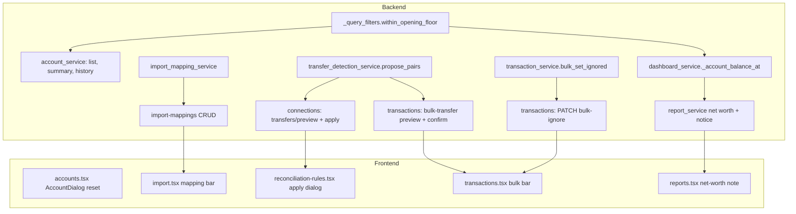

# Selfhost.3 Adjustments Design

**Spec**: `.specs/features/selfhost-3-adjustments/spec.md`
**Status**: Draft

---

## Architecture Overview

Six changes on the existing FastAPI/SQLAlchemy + React stack. Two share a core: the balance floor (B2) is one SQL fragment reused by every balance read site; the pairing engine (F2/F4) is one proposal function reused by two endpoints.



### Approaches considered for the balance floor (B2)

| Approach | Description | Trade-off |
| -------- | ----------- | --------- |
| **A. Query-time floor (recommended)** | One correlated-subquery filter reading the account's `opening_balance` row date; every balance read applies it | No migration, no data change, edit of the opening date is immediately correct; every read site must adopt the fragment |
| B. Stored `balance_start_date` column on `accounts` | Persist the floor on the account, filter on it | Migration + backfill, a second source of truth that can drift from the opening row |
| C. Mutate or flag old transactions | Mark earlier rows `excluded_from_balance` | Destroys the "keep history visible and reportable" requirement, writes on every edit |

Recommended: **A**. Decision to confirm with the owner before Execute.

---

## Code Reuse Analysis

### Existing Components to Leverage

| Component | Location | How to Use |
| --------- | -------- | ---------- |
| `counts_in_current_balance`, `is_not_future` | `backend/app/services/_query_filters.py` | Add `within_opening_floor(cutoff)` beside them and compose |
| `get_accounts` balance subqueries | `backend/app/services/account_service.py:53-100` | Apply floor to `balance_sq` and `prev_balance_sq` |
| `get_account_summary` manual branch | `backend/app/services/account_service.py:696-722` | Apply floor |
| `_account_balance_at` (account) / `_account_daily_balance_series` | `account_service.py:1006-1070` | Apply cutoff-aware floor to start balance |
| `_account_balance_at` (dashboard) | `dashboard_service.py:1256` | Apply cutoff-aware floor on manual-account branch; connected branch unchanged |
| `get_net_worth_report` / `ReportResponse` / `ReportMeta` | `report_service.py:297+`, `schemas/` | Add `balance_resets` to the response meta |
| `detect_transfer_pairs`, `_pool`, `neighbours`, `evaluate` | `transfer_detection_service.py` | Extract the decision phase into `propose_pairs`; `detect_transfer_pairs` calls it then writes |
| Bulk endpoints pattern | `api/transactions.py:262-320`, `transaction_service.bulk_update_category` | Same shape for `bulk-ignore` |
| `column_mapping` form field and `parse_csv` | `api/import_transactions.py`, `import_service.py` | Saved mapping serializes exactly this dict |
| Bulk toolbar and mutations | `frontend/src/pages/transactions.tsx:564-650` | Add ignore and transfer actions |
| `CSV_MAPPING_FIELDS`, `csvColumnMapping` state | `frontend/src/pages/import.tsx:30,83` | Drive save/apply |

### Integration Points

| System | Integration Method |
| ------ | ------------------ |
| Alembic | New revision `097` creating `import_mappings` (latest is `096`) |
| i18n | New keys in all 15 locale files under `frontend/src/locales`; `i18n.test.ts` guards parity |
| Reconciliation policy | Window, amount ratio and enabled strategies read via `rule_service.resolve(session, workspace_id, NODE)` |

---

## Components

### within_opening_floor (B2 core)

- **Purpose**: SQL predicate "this transaction counts toward the balance at cutoff c".
- **Location**: `backend/app/services/_query_filters.py`
- **Interface**: `within_opening_floor(cutoff: date) -> ColumnElement[bool]`
- **Logic**: `opening = (select max(o.date) from transactions o where o.account_id = Transaction.account_id and o.source = 'opening_balance').scalar_subquery()`; predicate `or_(opening.is_(None), cutoff < opening, Transaction.date >= opening)` using an aliased `Transaction` inside the subquery.
- **Reuses**: `app_today`, existing filter style.

### Balance sites (B2)

- **Purpose**: Make every balance read honor the floor.
- **Location**: `account_service.py`, `dashboard_service.py`
- **Rule**: manual accounts add `within_opening_floor(cutoff)`; connected accounts keep their provider-balance logic (spec BAL-01 AC8). Credit cards use the same predicate.

### Net-worth balance resets (NWN)

- **Purpose**: Tell the UI which accounts caused a floor discontinuity inside the window.
- **Location**: `report_service.py` (`_find_balance_resets`), `schemas/report.py`
- **Interface**: `_find_balance_resets(session, accounts, window_start, window_end) -> list[BalanceReset]`, `BalanceReset{account_id, account_name, date}`
- **Query**: per in-scope account, opening date `D` where `window_start < D <= window_end` and `exists(non-ignored tx with date < D)`. Single grouped query, not per account.
- **Frontend**: `reports.tsx` renders a note under the net-worth chart from `meta.balance_resets`.

### ImportMapping (IMP)

- **Purpose**: Persist per-user CSV mappings.
- **Location**: model `backend/app/models/import_mapping.py`, service `services/import_mapping_service.py`, router `api/import_mappings.py`, schema `schemas/import_mapping.py`.
- **Interfaces**:
  - `GET /import-mappings` list; `POST /import-mappings` create; `PATCH /import-mappings/{id}` rename or update; `DELETE /import-mappings/{id}`
  - `POST /import-mappings/match` body `{headers: string[]}` → `{matches: ImportMapping[]}` ordered by `last_used_at desc`
  - `POST /import-mappings/{id}/touch` sets `last_used_at` (called after a successful import)
- **Frontend**: `import.tsx` calls `match` after the preview returns `csv_columns`; shows badge, switch/remove controls and a "Save mapping" form (name + current account).

### propose_pairs (TRF/BTR)

- **Purpose**: Pure decision step that returns pairs without writing.
- **Location**: `transfer_detection_service.py`
- **Interface**: `propose_pairs(session, workspace_id, restrict_ids: set[UUID] | None) -> ProposalResult{pairs: list[ProposedPair], ambiguous: list[UUID], unmatched: list[UUID], already_linked: list[UUID]}`; `apply_pairs(session, workspace_id, pairs: list[tuple[UUID, UUID]]) -> ApplyResult{linked, skipped}`
- **Rule**: with `restrict_ids=None` the pool is every unpaired workspace row (F2); with a set, both legs must belong to it (F4). Only mutual `linked` decisions become pairs; `suggested` ones are dropped, and no suggestion is recorded.
- **Refactor**: `detect_transfer_pairs` keeps its signature and behavior (its `involves_new` rule and suggestion recording stay) and is covered by existing tests; the shared part is the pool + neighbour + `evaluate` loop.
- **Endpoints**: `GET /connections/transfers/preview`, `POST /connections/transfers/apply {pairs:[{a,b}]}`; `POST /transactions/bulk-transfer/preview {transaction_ids}`, `POST /transactions/bulk-transfer {pairs}` (confirm re-validates pairs against current state).

### bulk_set_ignored (IGN)

- **Purpose**: Explicit-state bulk update.
- **Location**: `transaction_service.py`, `api/transactions.py`, `schemas/transaction.py`
- **Interface**: `PATCH /transactions/bulk-ignore {transaction_ids (max 100), ignored: bool}` → `{updated}`; rows already in the target state or in another workspace do not count.

### AccountDialog reset (ACC)

- **Purpose**: Reset create-mode state on every open.
- **Location**: `frontend/src/pages/accounts.tsx` (`AccountDialog`, ~l.668)
- **Approach**: reset when `open` flips to true (and when `account` changes) instead of comparing only `account`. Preferred minimal change: key the dialog body on an open counter (`key` incremented when opened) so the state re-initializes, replacing the `formSource` render-time pattern.

---

## Data Models

```python
class ImportMapping(Base):
    __tablename__ = "import_mappings"
    id: UUID                       # pk
    user_id: UUID                  # FK users.id ON DELETE CASCADE, index
    name: str                      # 1..100
    name_key: str                  # lower(name); UNIQUE (user_id, name_key)
    account_id: UUID | None        # FK accounts.id ON DELETE SET NULL
    headers: list[str]             # JSON, sorted, trimmed
    headers_key: str               # sha256 of the sorted headers, index (user_id, headers_key)
    column_mapping: dict[str, str] # JSON, field -> header
    options: dict                  # JSON: date_format, flip_amount, inflow_column, outflow_column
    last_used_at: datetime | None
    created_at / updated_at: datetime
```

**Relationships**: belongs to `users`; optional link to `accounts`. Per user, not per workspace (PRD).

---

## Error Handling Strategy

| Error Scenario | Handling | User Impact |
| -------------- | -------- | ----------- |
| Duplicate mapping name | 409 with message | Inline error under the name field |
| >100 IDs in bulk request | 422 via `max_length=100` on the schema | Toast; UI also caps selection actions with a disabled state and hint |
| Pair stale at apply time | Skipped and returned in `skipped` | Toast "N linked, M skipped" |
| Destination account deleted | FK `SET NULL`; mapping applies without account | No preselected account |
| Preview with transfer rule fully disabled | Empty proposal | Empty state message |

---

## Risks & Concerns

| Concern | Location (file:line) | Impact | Mitigation |
| ------- | -------------------- | ------ | ---------- |
| Balance logic is duplicated across 4 services (`_account_balance_at` exists in both `account_service` and `dashboard_service`) | `account_service.py:1006`, `dashboard_service.py:1256` | A site missed by B2 shows a different balance | One shared predicate; a test per site asserts the same value for the same fixture |
| `sync_opening_balance_for_connected_account` computes the opening amount from all transactions | `account_service.py:458-575` | A floor mismatch would change connected balances | Floor is a no-op there (opening date = oldest counted tx - 1); regression test with connected fixture |
| Edit form always sends `balance_date` (today) for manual accounts | `accounts.tsx:735` | Editing only the name could silently move the opening date and, with B2, the floor | Backend only touches the opening row when `balance` is in the payload (`account_service.py:391`); add a test that a name-only edit keeps the opening date, and make the frontend send `balance`/`balance_date` only when changed |
| `detect_transfer_pairs` is critical to sync | `transfer_detection_service.py:206` | Refactor regression in automatic pairing | Keep public behavior; run existing transfer tests before and after; extract by moving code, not rewriting |
| Net-worth series uses per-point balance queries | `report_service.py:157` | Extra queries for notice | Notice computed once per request with a grouped query |
| Existing single toggle is the only ignore path | `transaction_service.py:1836` | None | Leave unchanged |
| Page size max is 500 while bulk cap is 100 | `api/transactions.py:127` | "Select all" can exceed 100 | UI disables bulk actions above 100 with a clear hint; backend enforces |

---

## Tech Decisions (only non-obvious ones)

| Decision | Choice | Rationale |
| -------- | ------ | --------- |
| Floor storage | Derived from the opening row at query time | No migration, no drift |
| Past-cutoff semantics | Floor applies only when cutoff ≥ opening date | Keeps historical report series intact per owner decision |
| Mapping scope | Per user, keyed by header-set hash | Owner decision; exact match avoids false positives |
| Pair confirm payload | Explicit `(a, b)` pairs, revalidated server-side | Preview and apply can differ in time; server never trusts the client's pairing |
| Bulk-ignore state | Explicit boolean | Avoids inverting mixed selections |

> **Project-level decision to record (AD-001):** an account's balance is derived from its `opening_balance` row and counts only transactions dated on or after it. Future balance work must use `within_opening_floor`.
